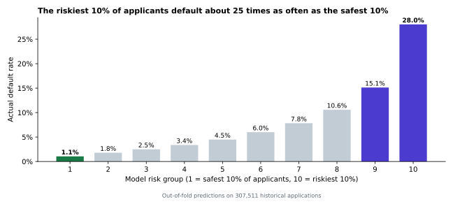

# Predicting Loan Default for Home Credit

**Marco Rodriguez** · MS Business Analytics, University of Utah · IS 6812 Capstone

A credit risk model that helps a lender serving people with little or no credit history approve more good borrowers and lose less to default. Built end to end in Python on 307,511 real loan applications, from exploratory analysis through a deployment-ready model card.

| | |
|---|---|
| **Final model** | LightGBM, 249 engineered features, AUC **0.769** (cross-validated) and **0.763** on Kaggle's hidden test set |
| **Business result** | At a cost-based cutoff, the default rate on approved loans falls from **8.1% to 4.2%** and back-tested net profit rises about **72%** |
| **Deliverables** | EDA, reusable data preparation script, modeling notebook, model card with SHAP, fairness and adverse action analysis |

---

## Contents

1. [Business problem](#business-problem)
2. [My solution](#my-solution)
3. [Business value](#business-value)
4. [Difficulties along the way](#difficulties-along-the-way)
5. [What I learned](#what-i-learned)
6. [Portfolio notebooks](#portfolio-notebooks)
7. [How to reproduce](#how-to-reproduce)

---

## Business problem

[Home Credit](https://www.homecredit.net/) lends to people who have little or no formal credit history, the customers traditional banks turn away. Without a bureau score, approval decisions carry avoidable error in both directions:

- **Approving applicants who cannot repay** creates direct credit losses. About **8.1%** of past loans ran into payment difficulty.
- **Declining applicants who would have repaid** gives up profit and works against the company's mission of expanding access to credit. **13.5%** of applicants have no credit bureau inquiry record at all.

**Project objective:** build a risk score from data Home Credit already collects at application time that reduces defaults among approved loans without shutting out creditworthy thin-file applicants. Success target: a 10% relative reduction in the default rate among approved loans.

The data comes from the [Home Credit Default Risk](https://www.kaggle.com/competitions/home-credit-default-risk) competition on Kaggle.

## My solution

I worked through the full analytics lifecycle (CRISP-DM), with each stage feeding the next.

1. **Exploratory data analysis.** Answered 11 business questions about the data. Key findings:
   - External credit scores are the strongest signal; their average alone reaches an AUC of 0.72.
   - A placeholder value (`DAYS_EMPLOYED = 365243`, "1,000 years employed") hid 55,374 pensioners who default at only 5.4%.
   - Thin-file applicants default at 10.3% versus 7.7%, and borrowing more than 30% above the price of the goods doubles the default rate.
2. **Reusable data preparation** ([`data_preparation.py`](data_preparation.py)). A fit/transform design that learns every value (caps, medians, category levels) from training data only and applies it identically to new data, producing 252 features with no missing values and built-in consistency checks.
3. **Modeling.** Compared logistic regression, random forest, XGBoost and LightGBM with 3-fold cross-validation on AUC, tested four class-imbalance strategies, and tuned LightGBM with a randomized search:

   | Model | CV AUC |
   |---|---|
   | Majority class (approve everyone) | 0.500 |
   | Logistic regression, EDA shortlist | 0.742 |
   | Random forest | 0.747 |
   | XGBoost | 0.766 |
   | **LightGBM, tuned (final)** | **0.769** |

4. **Model card.** Set a decision threshold from researched lending economics (Home Credit's reported margins and published recovery rates), explained predictions with SHAP, translated the top features into legally required plain-language decline reasons, and tested approval rates across gender and education groups.



## Business value

Back-tested on 307,511 historical loans, at a **10% default-probability cutoff**:

| Metric | Approve everyone | With the model |
|---|---|---|
| Approval rate | 100% | 75% |
| Default rate among approved loans | 8.1% | **4.2%** |
| Net profit (billions, local currency) | 3.94 | **6.79** |

- **Defaults cut nearly in half**, far beyond the 10% reduction target.
- **About 72% more profit**, because losses avoided outweigh the margin given up on declined good borrowers.
- **Explainable decisions:** every decline comes with specific reasons, such as "loan amount is high relative to the price of the goods financed", ready for adverse action notices.
- **A safe path to deployment:** a 3-month shadow test, a 10 to 20% pilot, then full rollout with monthly monitoring of accuracy, calibration and fairness.
- **Compliance risk caught early:** the analysis found that the model uses marital status, which U.S. fair lending law prohibits. Removing it costs no accuracy (AUC 0.7687 vs 0.7688).

## Difficulties along the way

- **Hidden placeholder values.** Codes like 365,243 days employed and cars "65 years old" looked like data but meant "not applicable". Treating them as numbers would have taught the model nonsense, so I recoded them and kept a flag, because the placeholder itself predicted lower risk.
- **Train/test consistency.** My first preparation script produced a blank in the test set that training never had (a `-1` region rating). The automated consistency checks I built caught it, and I changed the design to learn a fill value for every column.
- **Class imbalance.** With only 8% defaults, a model that approves everyone is 92% accurate and useless. SMOTE, upsampling, downsampling and class weights all failed to beat the unadjusted model, and they distorted the probabilities, so I handled the imbalance through the decision threshold instead.
- **Tuning that made things worse.** Hyperparameters tuned on a 60,000-row sample scored *below* the untuned model on the full data, because more data supports more trees. Re-selecting the number of trees with early stopping on the full data fixed it.
- **No real cost data.** The dataset has no margins or recovery rates. I researched Home Credit's published financials and academic recovery studies, and showed in a sensitivity analysis how the best cutoff moves (about 5% to 22%) as those assumptions change.
- **Limited computing power.** Everything ran on a 2-core, 7 GB machine, so I used sampling, 3-fold validation and randomized search to keep run times practical.

## What I learned

- **Pick the metric that matches the decision.** AUC measures how well a model ranks risk; accuracy is misleading when the event is rare.
- **Calibrated probabilities are worth protecting.** Because the model's 15% means about 15 in 100 default, the profit-optimal cutoff is simply margin ÷ (margin + loss), and the back-test confirmed it.
- **Leakage is subtle.** Learning preparation values from training data only, and resampling only inside training folds, kept the performance estimates honest; the Kaggle score landed within 0.006 of cross-validation.
- **A model is not finished when it is accurate.** Explaining decisions (SHAP), meeting legal requirements (adverse action, ECOA) and checking fairness (four-fifths rule) decide whether it can be deployed.
- **Business framing beats technical detail.** Stakeholders act on "defaults fall from 8.1% to 4.2%", not on "AUC 0.769".
- **Using AI tools well.** I used Claude (Anthropic) as a coding and writing partner, and learned that my value is in framing the questions, checking every number against the data, and catching errors, including a claim about loan length that the data did not support.

## Portfolio notebooks

GitHub cannot display rendered HTML, so each notebook is included as a PDF of the compiled report alongside its Quarto source.

| Stage | Report (PDF) | Source |
|---|---|---|
| 1. Exploratory data analysis | [1_EDA.pdf](reports/1_EDA.pdf) | [eda.qmd](notebooks/eda.qmd) |
| 2. Data preparation | [Documentation](docs/technical_details.md#data-preparation-script) | [data_preparation.py](data_preparation.py) |
| 3. Modeling | [2_Modeling.pdf](reports/2_Modeling.pdf) | [modeling.qmd](notebooks/modeling.qmd) |
| 4. Model card | [3_Model_Card.pdf](reports/3_Model_Card.pdf) | [model_card.qmd](notebooks/model_card.qmd) |

Supporting documents:

- [Technical details](docs/technical_details.md): every data preparation decision mapped to the EDA, model comparison and model card summary.
- [Feature report](docs/feature_report.md): research on the risk factors lenders use, mapped to the dataset.

## How to reproduce

**Requirements:** Python 3.10+, Quarto, and `pandas`, `numpy`, `pyarrow`, `scikit-learn`, `imbalanced-learn`, `lightgbm`, `xgboost`, `shap`, `matplotlib`, `seaborn`.

1. Download `application_train.csv` and `application_test.csv` from the [Kaggle competition](https://www.kaggle.com/competitions/home-credit-default-risk/data) into `data/raw/`.
2. Run `python data_preparation.py` from the project root (about 25 seconds).
3. From `notebooks/`, render in order: `quarto render eda.qmd`, `quarto render modeling.qmd` (about 25 minutes; saves the model to `models/`), then `quarto render model_card.qmd`.

Data, trained models and Kaggle submissions are kept out of the repository by [`.gitignore`](.gitignore).

```
home-credit-project/
├── README.md
├── data_preparation.py
├── notebooks/        Quarto sources: eda, modeling, model_card
├── reports/          Compiled notebooks as PDF
├── docs/             Technical details, feature report, images
└── data/ models/     Local only (ignored)
```
